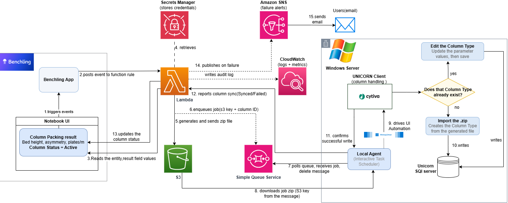

# UNICORN Packed Column Sync — Automation

Automation that syncs **packed column** data from Benchling into Cytiva
**UNICORN**'s Column Type library — without a human re-typing values and
without writing to UNICORN's database directly.

UNICORN exposes no API for column data (confirmed with Cytiva), and its
Technical Manual advises against writing to the database directly. So this
project drives UNICORN through supported application features — **Import**
and **Edit** in the Column Handling dialog — using Windows UI Automation and
WinAppDriver. All values are read from Benchling and written through the
application, so UNICORN's own validation and audit trail stay intact.

This repo (`unicorn_automation_test`) is the **on-prem consumer**: it watches
for jobs and drives the UNICORN desktop client. The upstream half that reads
Benchling and produces those jobs lives in
[`unicorn-column-lambda/`](unicorn-column-lambda/README.md).

## Contents

- [Architecture](#architecture)
- [Two write paths](#two-write-paths-both-verified-end-to-end)
- [Layout](#layout)
- [Prerequisites](#prerequisites)
- [Setup](#setup)
- [Usage](#usage)
  - [SQS/S3 pipeline](#sqss3-pipeline)
  - [Run it continuously](#run-it-continuously-auto-triggered)
- [Import archive format](#import-archive-format-reverse-engineered)
- [Critical gotchas](#critical-gotchas-learned-the-hard-way)
- [Status](#status)

## Architecture

End-to-end flow, from a Benchling result field to a saved UNICORN column type:



1. A Benchling event (packed column result) triggers the Benchling App.
2. The app posts the event to a Lambda function rule.
3. Lambda reads the entity and its result field values from Benchling.
4. Lambda retrieves Benchling credentials from **Secrets Manager**.
5. Lambda generates the UNICORN import `.zip` and writes it to **S3**.
6. Lambda enqueues a job (S3 key + column ID) on **SQS**.
7. On the Windows host, the **Local Agent** (an interactive Task Scheduler
   job) polls the queue and receives the job.
8. The agent downloads the job's zip from S3.
9. The agent drives UI Automation against the **UNICORN Client**, via
   WinAppDriver.
10. UNICORN writes the column type to its **SQL Server** database — either
    by importing the zip (new column type) or editing an existing one.
11. The agent confirms the write succeeded.
12. The agent reports the result (Synced/Failed) back to Lambda.
13. On success, Lambda updates the column's status back in Benchling.
14. On failure, Lambda publishes to **Amazon SNS**.
15. SNS emails the on-call users.

Throughout, Lambda writes an audit log line to **CloudWatch**.

Steps 1–6 and 12–15 are implemented in
[`unicorn-column-lambda/`](unicorn-column-lambda/README.md); steps 7–11 are
implemented in this repo (`tools/sqs_pull.py`, `tools/watch_service.ps1`,
`tools/sync_column.ps1`).

## Two write paths (both verified end-to-end)

| Scenario | Path | How |
|---|---|---|
| Column type **does not exist** → create | **Import** | Generate a UNICORN import `.zip` from a Benchling record and import it via Column Handling → Import |
| Column type **exists** → update values | **Edit** | Select it, open Edit, set the writable cells, Save |

Reading the existing library (for dedup / reconciliation) is done by driving
the Column Handling list, not by querying the database.

## Layout

```
lib/                       Reusable modules (no side effects on import)
  wad.py                   Minimal WinAppDriver client (stdlib only)
  unicorn_coltype.py       Build & verify UNICORN column-type import archives
  win32_dialogs.ps1        Press UNICORN message-box buttons without a real mouse

tools/                     Runnable scripts
  sqs_pull.py              PRODUCER: poll SQS -> download/verify S3 archive -> queue job
  watch_service.ps1        CONSUMER: watch the folder, run sync_column per job
  sync_column.ps1          END-TO-END one column: search -> edit|import -> verify
  canary.ps1               Health check — run BEFORE any automation
  extract_column_types.ps1 Dump the whole Column Type library to CSV
  export_column_type.py    Export one column type to a .zip (inspect the format)
  generate_import.py       Offline sample/import archive generator

fixtures/                  Test data
  export_sample_a/b.zip    Real UNICORN exports (prove the archive format)
  corrupt_crc.zip          Bad-checksum archive (UNICORN rejects it)

docs/                      Write-ups, diagrams, and requests for stakeholders
exports/                   Runtime output (git-ignored)
```

Scripts locate `lib/` relative to their own path, so the project can live
anywhere — no absolute paths baked in.

## Prerequisites

- Windows, with **UNICORN** installed and the **Column Handling** dialog
  reachable (open it from System Control, Method Editor, or Evaluation Classic).
- **WinAppDriver** running and listening on `http://127.0.0.1:4723`
  (`"C:\Program Files (x86)\Windows Application Driver\WinAppDriver.exe"`).
  Needed for clicks; not needed for the offline `generate_import.py` or the
  `.NET`-UIA-only reads.
- **Developer Mode enabled** (Windows Settings → Update & Security → For
  Developers → Developer mode). This is a Microsoft requirement for
  WinAppDriver itself, not specific to this project — WinAppDriver will not
  install/run without it. On a Lilly-managed host this is a policy setting
  that needs Cyber Security sign-off, not something a user can silently turn
  on.
- **A Windows Credential Manager entry** named `UNICORN_AGENT` holding the
  UNICORN login username/password (`cmdkey /generic:UNICORN_AGENT
  /user:<unicorn-username> /pass:<password>`, or Control Panel → Credential
  Manager → Windows Credentials → Add a Windows Credential). Read by
  `tools/ensure_unicorn.ps1`; never stored in `.env` or any file.
- **Python 3**. The SQS/S3 producer uses `boto3`; the local automation and
  archive tools otherwise use the standard library.

## Setup

```powershell
# 1. Configuration — copy the template and adjust if needed
Copy-Item .env.example .env

# 2. Virtual environment (recommended)
python -m venv .venv
.\.venv\Scripts\Activate.ps1
pip install -r requirements.txt        # boto3 for the SQS/S3 producer
pip install -r requirements-dev.txt    # pytest for the Python test suite
```

Configuration lives in **`.env`** (git-ignored; copy from `.env.example`) and
is read by both `lib/config.py` (Python) and `lib/env.ps1` (PowerShell):

| Variable | Default | Meaning |
|---|---|---|
| `WINAPPDRIVER_URL` | `http://127.0.0.1:4723` | WinAppDriver endpoint |
| `UNICORN_PROCESS` | `UNICORNClient` | UNICORN client process name |
| `COLUMN_DIALOG_TITLE` | `Column Handling` | dialog to attach to |
| `IMPORT_ACCESS_SCOPE` | `Personal` | scope for generated imports (`Personal`/`Global`) |
| `EXPORTS_DIR` | `<root>/exports` | where output is written |
| `SQS_QUEUE_URL` | *(unset)* | required queue URL for `sqs_pull.py` |
| `AWS_REGION` | `us-east-2` | AWS region for SQS/S3 |
| `AWS_PROFILE` | *(default credential chain)* | optional named AWS profile |

Precedence: real environment variable > `.env` > built-in default.

## Usage

End-to-end sync of one column type (the whole flow in one command):

```powershell
# Update an existing column type's parameters, then verify
powershell -NoProfile -ExecutionPolicy Bypass -File tools\sync_column.ps1 `
    -ColumnName 'ZZTEST' -Set 'Default flow rate=2.5;Max flow rate=3.0'

# Create one from a generated import file (used when it doesn't exist yet)
powershell -NoProfile -ExecutionPolicy Bypass -File tools\sync_column.ps1 `
    -ColumnName 'ZZTEST-BenchlingSync-DELETE-ME 1x10cm 7.9mL' `
    -ImportZip exports\ZZTEST_import.zip
```

Or start with just the health check:

```powershell
powershell -NoProfile -ExecutionPolicy Bypass -File tools\canary.ps1
```

### SQS/S3 pipeline

The SQS producer long-polls the configured queue, downloads the archive from
S3, verifies its UNICORN checksums, then writes the archive and job into
`<WATCH_DIR>/incoming`. It acknowledges an SQS message only after handoff;
invalid archives are placed in `failed/` and acknowledged so they are not
retried indefinitely.

```powershell
# Start the SQS poller (AWS credentials must be available to boto3).
python tools\sqs_pull.py

# Or poll the current queue once and exit when it is empty.
python tools\sqs_pull.py --once

# Run the watcher separately; it consumes incoming jobs and drives UNICORN.
powershell -NoProfile -ExecutionPolicy Bypass -File tools\watch_service.ps1

# One pass through currently queued jobs, then exit.
powershell -NoProfile -ExecutionPolicy Bypass -File tools\watch_service.ps1 -Once
```

`watch_service.ps1` can be registered as a scheduled task as described below.
The SQS poller must also be kept running on the Windows host; configure its
startup separately for your deployment.

The watcher processes jobs one at a time (UNICORN has a single desktop). It
can also be registered as a scheduled task. For offline archive generation
and format checks, see `tools/generate_import.py` and `lib/unicorn_coltype.py`.

### Run it continuously (auto-triggered)

`watch_service.ps1` is event-driven: it blocks on a `FileSystemWatcher` and
fires as soon as a `.job.json` lands, with a periodic safety sweep (default 5 s)
so nothing is ever missed. To make it start automatically and stay running,
register it as a **scheduled task** (run from an elevated shell):

```powershell
powershell -NoProfile -ExecutionPolicy Bypass -File tools\install_watch_task.ps1
# remove with:  ... install_watch_task.ps1 -Uninstall
```

**It is registered as a Scheduled Task, not a Windows Service — on purpose.**
A Windows Service runs in Session 0, which cannot see or click UNICORN's UI.
The task runs in the **interactive logged-on session** (`LogonType Interactive`,
`RunLevel Highest`), which is the only context where the automation can drive
the desktop. Verified the hard way: the same watcher launched as a *detached*
process fails at the Edit click because a background process cannot bring
UNICORN to the foreground for the synthetic mouse click. Requirements:

- a **dedicated host kept logged on and unlocked** (UIA stops on a locked
  desktop),
- UNICORN + WinAppDriver running in that session,
- single display / primary monitor (WinAppDriver misses negative coordinates).

Generate an import file from a Benchling record (offline, safe):

```bash
python tools/generate_import.py        # edit RECORD in the file, or import build_xml()
```

Dump the current library for field mapping / dedup:

```powershell
powershell -NoProfile -ExecutionPolicy Bypass -File tools\extract_column_types.ps1 -Limit 25
```

Verify a generated archive is well-formed (matches UNICORN's checksums):

```bash
python lib/unicorn_coltype.py          # self-test against fixtures/
```

## Import archive format (reverse-engineered)

A column-type export/import is a plain **ZIP** (UNICORN 7.10, `FormatVersion="2"`):

- `ColumnType.xml` — UTF-8, no BOM. Root `<ColumnTypes>` is plural, so **one
  file can carry many column types** (batch import).
- `Manifest.xml` — two CRC-32 integrity checks. **UNICORN enforces these** —
  a mismatched checksum is rejected (`corrupt_crc.zip` demonstrates this).
  `unicorn_coltype.py` reproduces both, byte-identically to UNICORN's own output.

`<AccessScopeName>` controls visibility: **`Personal`** (only the creator sees
it — use for testing) or **`Global`** (everyone — production).

## Critical gotchas (learned the hard way)

- **Never call `InvokePattern.Invoke()` on a control that opens a modal.** It
  blocks UNICORN's entire UI Automation provider; killing the process while it
  is blocked corrupts the provider until UNICORN is restarted. Click via
  WinAppDriver (or synthetic mouse) instead. `canary.ps1` detects a corrupted
  provider.
- **A tab's controls exist in the UI tree only while that tab is selected.**
  Select the tab first.
- **List selection needs a real click**, not `SelectionItemPattern.Select()` —
  Select() moves the highlight but does not fire the event that repopulates the
  parameter grids.
- **WinAppDriver clicks miss at negative screen coordinates** (UNICORN on a
  left/upper secondary monitor). Use synthetic mouse, or move the window onto
  the primary monitor first.
- **Message-box buttons** (Yes/No, OK) are invisible to UIA. Press them with
  `SendMessage(btn, BM_CLICK)` — **not** `PostMessage` (silently ignored).
  See `lib/win32_dialogs.ps1`.

## Status

- Import (create) and Edit (update) both proven against the live client.
- Nine UNICORN-required fields map from Benchling as: 4 direct/constant, 5 from
  a maintained resin/hardware lookup. See `docs/` for the field mapping and the
  open requirements questions (naming convention, the resin lookup source,
  inactive-column handling).
